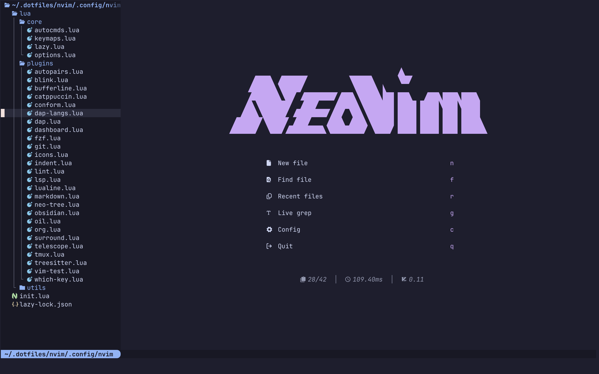

I've been using Neovim for the last 1.5 years and I genuinely love it. I got to know about Neovim from Stack Overflow and YouTube. I had a very old Sony laptop from 2010 running Windows 7 — it was my first laptop and I was using VSCode on it, but it used to lag a lot. I couldn't even use the browser properly. So I searched online and found out about Ubuntu, which turned out to be one of the best decisions I've ever made — not just for performance, but because it taught me Linux CLI which every developer should know.

That same post also mentioned Neovim as a lightweight editor that works great on Linux. It was the first time I'd ever heard of Neovim. I already knew Vim motions since I used to use them in VSCode with the Vim extension — I had searched on YouTube for "must have VSCode extensions" and someone recommended it. It had a learning curve but I loved it so much.

For the first few days I just used Vim with a simple `.vimrc`, then I finally installed Neovim and started making my own config from scratch. I got tons of errors since I didn't know what I was doing — it was mostly pasting code from GitHub repos and YouTube videos that I didn't understand. I got to know about LSP, completion, linting and other stuff but didn't understand how the code actually worked.

After some time I got a new laptop — a MacBook M1. This time I just downloaded VSCode and used it for a while. I was also moving from backend development to machine learning at this point. But since late 2023 I've been deep into applied AI/ML which involves lots of backend work, and I kept finding myself with two or more terminals open in VSCode. So I decided to give Neovim one more chance — but this time I would understand each and every line of code in my config. I got tons of errors again, but this time I used AI to help me understand what my config was actually doing. Now I think I have one of the best configs — at least according to me.


## Before You Start: My Recommendation for Beginners

If you're completely new to Neovim, don't start by building your own config. Follow this path first:

1. **Learn Vim motions in VSCode** — install the Vim extension and use it for a few weeks until `hjkl`, `w`, `b`, `ci"`, `yap` feel natural. Don't skip this step.
2. **Use a distro** — install [LazyVim](https://lazyvim.org), [NvChad](https://nvchad.com), or [AstroNvim](https://astronvim.com). These come pre-configured with everything working. LazyVim is my recommendation — it's well maintained, beginner friendly, and easy to extend with custom plugins.
3. **Then build your own** — once you're comfortable and understand how things fit together, start from scratch. But understand most of the things in your config — don't just blindly copy paste.

This guide is for step 3.


## Directory Structure

A clean Neovim config follows this structure:

```
~/.config/nvim/
├── init.lua                    -- entry point, loads everything
└── lua/
    ├── core/
    │   ├── lazy.lua            -- plugin manager bootstrap
    │   ├── options.lua         -- vim options
    │   ├── keymaps.lua         -- global keymaps
    │   └── autocmds.lua        -- autocommands
    └── plugins/
        ├── lsp.lua             -- LSP + Mason
        ├── blink.lua           -- completion
        ├── conform.lua         -- formatting
        ├── lint.lua            -- linting
        ├── treesitter.lua      -- syntax highlighting
        ├── fzf.lua             -- fuzzy finder (primary)
        ├── telescope.lua       -- fuzzy finder (secondary)
        ├── neo-tree.lua        -- file tree sidebar
        ├── oil.lua             -- filesystem editor
        ├── which-key.lua       -- keymap popup
        ├── icons.lua           -- mini.icons
        ├── dap.lua             -- debugging core
        └── dap-langs.lua       -- debug adapters per language
```

Each file in `lua/plugins/` is auto-imported by lazy.nvim — you don't need to manually register each one.


## Entry Point: init.lua

```lua
require("core.lazy")
```

That's it. One line. Everything loads from `core/lazy.lua`.


## Plugin Manager: lazy.nvim

lazy.nvim is the standard plugin manager in 2025. It supports lazy loading — plugins only load when actually needed, which means faster startup. It also auto-bootstraps itself on a new machine so you never need to manually install it.

**`lua/core/lazy.lua`**

```lua
-- Bootstrap lazy.nvim — clones itself if not present
local lazypath = vim.fn.stdpath("data") .. "/lazy/lazy.nvim"
if not (vim.uv or vim.loop).fs_stat(lazypath) then
    local lazyrepo = "https://github.com/folke/lazy.nvim.git"
    local out = vim.fn.system({
        "git", "clone", "--filter=blob:none", "--branch=stable", lazyrepo, lazypath
    })
    if vim.v.shell_error ~= 0 then
        vim.api.nvim_echo({
            { "Failed to clone lazy.nvim:\n", "ErrorMsg" },
            { out, "WarningMsg" },
            { "\nPress any key to exit..." },
        }, true, {})
        vim.fn.getchar()
        os.exit(1)
    end
end
vim.opt.rtp:prepend(lazypath)

-- Leader key must be set before lazy loads
vim.g.mapleader = " "
vim.g.maplocalleader = "\\"

-- Load core configs
require("core.autocmds")
require("core.keymaps")
require("core.options")

-- Setup lazy
require("lazy").setup({
    spec = {
        { import = "plugins" }, -- auto-imports all files in lua/plugins/
    },
    install = { colorscheme = { "catppuccin" } },
    checker = { enabled = true },
})
```


## Options: lua/core/options.lua

Basic Neovim settings every config needs:

```lua
local opt = vim.opt

-- Line numbers
opt.number = true
opt.relativenumber = true

-- Indentation (4 spaces)
opt.tabstop = 4
opt.shiftwidth = 4
opt.expandtab = true
opt.autoindent = true

-- Search
opt.ignorecase = true
opt.smartcase = true
opt.hlsearch = false

-- UI
opt.termguicolors = true
opt.signcolumn = "yes"   -- always show sign column so it doesn't shift
opt.cursorline = true
opt.scrolloff = 8        -- keep 8 lines above/below cursor

-- Splits open in natural direction
opt.splitright = true
opt.splitbelow = true

-- Files
opt.swapfile = false
opt.backup = false
opt.undofile = true      -- persistent undo across sessions

-- Performance
opt.updatetime = 250     -- faster CursorHold events
opt.timeoutlen = 300
```


## Icons: mini.icons

Before setting up anything visual, install icons. For a long time everyone used **nvim-web-devicons** for file type icons. I switched to **mini.icons** which is what LazyVim uses now — it's faster and more consistent.

The smart part is the mock — any plugin that depends on nvim-web-devicons automatically uses mini.icons instead without you changing anything in those plugins:

**`lua/plugins/icons.lua`**

```lua
return {
    {
        "echasnovski/mini.icons",
        lazy = true,
        opts = {},
        init = function()
            -- mock nvim-web-devicons so all plugins use mini.icons instead
            package.preload["nvim-web-devicons"] = function()
                require("mini.icons").mock_nvim_web_devicons()
                return package.loaded["nvim-web-devicons"]
            end
        end,
    },
}
```


## LSP: Language Server Protocol

LSP is what gives Neovim IDE features — go-to-definition, hover documentation, error highlighting, rename symbol, code actions. Without it Neovim is just a fancy text editor. With it, it's a full IDE.

Three Mason plugins work together to make this automatic:

- **mason.nvim** — the installer UI, like a package manager for developer tools
- **mason-lspconfig.nvim** — bridges Mason with Neovim's built-in LSP, auto-installs and starts servers
- **mason-tool-installer.nvim** — auto-installs formatters and linters (mason-lspconfig only handles LSP servers)

I'm using the Neovim 0.11+ API (`vim.lsp.config`) which is cleaner than the old approach. The old way required calling `lspconfig.server_name.setup()` for every single server. The new way lets you set global capabilities once and configure servers declaratively.

**`lua/plugins/lsp.lua`**

```lua
return {
    -- Mason: core installer UI
    {
        "mason-org/mason.nvim",
        build = ":MasonUpdate",
        opts = {},
    },

    -- Mason Tool Installer: auto-installs formatters + linters
    {
        "WhoIsSethDaniel/mason-tool-installer.nvim",
        dependencies = { "mason-org/mason.nvim" },
        opts = {
            ensure_installed = {
                -- formatters
                "stylua", "black", "isort",
                "clang-format", "prettierd",
                "gofumpt", "goimports",
                -- linters
                "pylint",
            },
            run_on_start = true,
        },
    },

    -- Mason LSP Bridge (v2 API)
    {
        "mason-org/mason-lspconfig.nvim",
        dependencies = {
            "mason-org/mason.nvim",
            "neovim/nvim-lspconfig",
        },
        config = function()
            -- Apply blink.cmp capabilities to all servers globally
            vim.lsp.config("*", {
                capabilities = require("blink.cmp").get_lsp_capabilities(),
            })

            -- Lua
            vim.lsp.config("lua_ls", {
                settings = {
                    Lua = {
                        runtime = { version = "LuaJIT" },
                        diagnostics = { globals = { "vim" } },
                        workspace = {
                            checkThirdParty = false,
                            library = vim.api.nvim_get_runtime_file("", true),
                        },
                        telemetry = { enable = false },
                    },
                },
            })

            -- Python
            vim.lsp.config("pyright", {
                settings = {
                    python = {
                        analysis = {
                            typeCheckingMode = "basic",
                            autoSearchPaths = true,
                            useLibraryCodeForTypes = true,
                            diagnosticMode = "workspace",
                        },
                    },
                },
            })

            -- C/C++: offset_encoding utf-16 is required by clangd
            vim.lsp.config("clangd", {
                offset_encoding = "utf-16",
                cmd = {
                    "clangd",
                    "--background-index",
                    "--clang-tidy",
                    "--header-insertion=iwyu",
                    "--completion-style=bundled",
                    "--function-arg-placeholders=true",
                },
                init_options = {
                    usePlaceholders = true,
                    completeUnimported = true,
                    clangdFileStatus = true,
                },
            })

            -- TypeScript/JavaScript
            vim.lsp.config("ts_ls", {})

            -- ESLint: handles JS/TS linting via LSP
            vim.lsp.config("eslint", {})

            -- Markdown
            vim.lsp.config("marksman", {})

            -- Rust: rust-analyzer with clippy for linting
            vim.lsp.config("rust_analyzer", {
                settings = {
                    ["rust-analyzer"] = {
                        checkOnSave = true,
                        check = { command = "clippy" },
                        cargo = { allFeatures = true },
                    },
                },
            })

            -- Go
            vim.lsp.config("gopls", {
                settings = {
                    gopls = {
                        analyses = { unusedparams = true },
                        staticcheck = true,
                        gofumpt = true,
                    },
                },
            })

            -- Install servers + auto-start on attach
            require("mason-lspconfig").setup({
                ensure_installed = {
                    "lua_ls", "pyright", "clangd",
                    "ts_ls", "eslint", "marksman",
                    "rust_analyzer", "gopls",
                },
                automatic_enable = true,
            })

            -- LSP keymaps: scoped to buffer, set on LspAttach
            vim.api.nvim_create_autocmd("LspAttach", {
                group = vim.api.nvim_create_augroup("user_lsp", { clear = true }),
                callback = function(args)
                    local opts = { buffer = args.buf, silent = true }
                    vim.keymap.set("n", "gd",         vim.lsp.buf.definition,  opts)
                    vim.keymap.set("n", "K",           vim.lsp.buf.hover,       opts)
                    vim.keymap.set("n", "gr",          vim.lsp.buf.references,  opts)
                    vim.keymap.set("n", "<leader>rn",  vim.lsp.buf.rename,      opts)
                    vim.keymap.set({ "n", "v" }, "<leader>ca", vim.lsp.buf.code_action, opts)
                    vim.keymap.set("n", "[d",          vim.diagnostic.goto_prev, opts)
                    vim.keymap.set("n", "]d",          vim.diagnostic.goto_next, opts)
                end,
            })

            -- Diagnostics with icons
            vim.diagnostic.config({
                virtual_text = true,
                signs = {
                    text = {
                        [vim.diagnostic.severity.ERROR] = " ",
                        [vim.diagnostic.severity.WARN]  = " ",
                        [vim.diagnostic.severity.HINT]  = "󰌵 ",
                        [vim.diagnostic.severity.INFO]  = " ",
                    },
                },
                underline = true,
                update_in_insert = false,
                severity_sort = true,
            })

            -- Float diagnostic on cursor hold
            vim.api.nvim_create_autocmd("CursorHold", {
                callback = function()
                    vim.diagnostic.open_float(nil, { focusable = false })
                end,
            })
        end,
    },
}
```

## Completion: blink.cmp

For a long time the standard completion engine was **nvim-cmp**. It worked well but needed several plugins — nvim-cmp itself, cmp-nvim-lsp for LSP completions, LuaSnip for snippets, cmp_luasnip to bridge them, and friendly-snippets for the actual snippet collection. That's 5 plugins for one feature.

**blink.cmp** replaces all of that. It has built-in snippet support, built-in LSP integration, and faster fuzzy matching with a Rust implementation. LazyVim switched to it and it's now the modern standard.

**`lua/plugins/blink.lua`**

```lua
return {
    {
        "saghen/blink.cmp",
        dependencies = "rafamadriz/friendly-snippets", -- snippet collection
        version = "1.*",
        opts = {
            snippets = { preset = "default" },

            -- default preset keymaps:
            -- <C-space> → open completion menu
            -- <C-y>     → accept selected item
            -- <C-e>     → hide menu
            -- <C-n/p>   → select next/prev item
            -- <C-b/f>   → scroll documentation
            keymap = { preset = "default" },

            appearance = {
                use_nvim_cmp_as_default = false,
                nerd_font_variant = "mono",
            },

            sources = {
                default = { "lsp", "path", "snippets", "buffer" },
            },

            completion = {
                -- auto-add brackets after accepting a function
                accept = { auto_brackets = { enabled = true } },
                documentation = {
                    auto_show = true,
                    auto_show_delay_ms = 200,
                },
                menu = {
                    draw = {
                        treesitter = { "lsp" }, -- better syntax highlighting in menu
                    },
                },
            },

            -- use rust fuzzy matching, fallback to lua if unavailable
            fuzzy = { implementation = "prefer_rust_with_warning" },
        },
        opts_extend = { "sources.default" },
    },
}
```


## Formatting: conform.nvim

Formatting fixes code style — indentation, spacing, line length. It runs automatically on every save so you never think about it.

The difference between a formatter and a linter: a **formatter** fixes code style automatically. A **linter** points out bugs and bad practices but doesn't fix them automatically.

Note I use `prettierd` instead of `prettier` — prettierd runs as a daemon (stays running in the background) so it doesn't restart on every save. Much faster.

**`lua/plugins/conform.lua`**

```lua
return {
    {
        "stevearc/conform.nvim",
        event = "BufWritePre",
        opts = {
            formatters_by_ft = {
                lua             = { "stylua" },
                python          = { "isort", "black" }, -- isort first (sorts imports), black second
                c               = { "clang-format" },
                cpp             = { "clang-format" },
                javascript      = { "prettierd" },
                typescript      = { "prettierd" },
                javascriptreact = { "prettierd" },
                typescriptreact = { "prettierd" },
                markdown        = { "prettierd" },
                json            = { "prettierd" },
                yaml            = { "prettierd" },
                html            = { "prettierd" },
                css             = { "prettierd" },
                rust            = { "rustfmt" },        -- comes with rustup, no Mason needed
                go              = { "gofumpt", "goimports" },
            },
            format_on_save = {
                timeout_ms = 2000,
                lsp_format = "fallback", -- use LSP formatting if no formatter configured
            },
        },
    },
}
```


## Linting: nvim-lint

Linting is separate from formatting. Formatters fix style. Linters find actual problems — unused variables, bad practices, potential bugs.

For Python I use pylint which catches things pyright misses. For JavaScript/TypeScript the ESLint LSP server handles linting directly so no separate linter config needed.

**`lua/plugins/lint.lua`**

```lua
return {
    {
        "mfussenegger/nvim-lint",
        event = "BufWritePost",
        config = function()
            require("lint").linters_by_ft = {
                python = { "pylint" }, -- extra checks beyond pyright
            }

            -- trigger linting after every save
            vim.api.nvim_create_autocmd("BufWritePost", {
                callback = function()
                    require("lint").try_lint()
                end,
            })
        end,
    },
}
```


## Fuzzy Finding: fzf-lua

fzf-lua is my primary fuzzy finder. It's faster than Telescope because it uses your system's native fzf binary rather than a Lua implementation. I use it for finding files, searching text across a project, switching buffers, and browsing git history.

**`lua/plugins/fzf.lua`**

```lua
return {
    {
        "ibhagwan/fzf-lua",
        dependencies = { "echasnovski/mini.icons" },
        cmd = "FzfLua",
        keys = {
            -- files
            { "<leader>ff", "<cmd>FzfLua files<cr>",                      desc = "Find files" },
            { "<leader>fr", "<cmd>FzfLua oldfiles<cr>",                   desc = "Recent files" },
            { "<leader>fb", "<cmd>FzfLua buffers<cr>",                    desc = "Buffers" },
            -- search
            { "<leader>fg", "<cmd>FzfLua live_grep<cr>",                  desc = "Live grep" },
            { "<leader>fw", "<cmd>FzfLua grep_cword<cr>",                 desc = "Grep word under cursor" },
            -- LSP
            { "<leader>fs", "<cmd>FzfLua lsp_document_symbols<cr>",      desc = "Document symbols" },
            { "<leader>fd", "<cmd>FzfLua diagnostics_document<cr>",      desc = "Diagnostics" },
            -- git
            { "<leader>gf", "<cmd>FzfLua git_files<cr>",                 desc = "Git files" },
            { "<leader>gc", "<cmd>FzfLua git_commits<cr>",               desc = "Git commits" },
        },
        opts = function()
            return {
                winopts = {
                    width  = 0.8,
                    height = 0.8,
                    row    = 0.5,
                    col    = 0.5,
                    preview = {
                        scrollchars = { "┃", "" },
                    },
                },
            }
        end,
    },
}
```

I also keep Telescope installed for one specific feature — `telescope-ui-select` which makes LSP code actions appear in a nice floating dropdown instead of the default command line prompt:

**`lua/plugins/telescope.lua`**

```lua
return {
    {
        "nvim-telescope/telescope.nvim",
        version = "*",
        cmd = "Telescope",
        dependencies = {
            "nvim-lua/plenary.nvim",
            {
                "nvim-telescope/telescope-fzf-native.nvim",
                build = "make",
                cond = function()
                    return vim.fn.executable("make") == 1
                end,
            },
            "nvim-telescope/telescope-ui-select.nvim", -- nicer code action picker
        },
        config = function()
            require("telescope").setup({
                extensions = {
                    ["ui-select"] = {
                        require("telescope.themes").get_dropdown({}),
                    },
                },
            })
            pcall(require("telescope").load_extension, "fzf")
            require("telescope").load_extension("ui-select")
        end,
    },
}
```


## File Management: neo-tree + oil.nvim

I use both plugins because they serve different purposes.

**neo-tree** is a sidebar file explorer — good for getting an overview of a project, seeing git status, and LSP diagnostics on files.

**oil.nvim** is something different. It opens the filesystem as a text buffer. You rename files by editing the text, delete files by deleting the line, create files by adding a line, then `:w` to apply all changes. It's much faster for bulk operations than any file explorer.

**`lua/plugins/neo-tree.lua`**

```lua
return {
    {
        "nvim-neo-tree/neo-tree.nvim",
        branch = "v3.x",
        dependencies = {
            "nvim-lua/plenary.nvim",
            "MunifTanjim/nui.nvim",
        },
        event = "VeryLazy",
        keys = {
            { "<leader>e", "<Cmd>Neotree toggle<CR>", desc = "Toggle file tree" },
        },
        opts = {
            close_if_last_window = true,
            enable_git_status    = true,
            enable_diagnostics   = true,
            window = {
                position = "left",
                width    = 32,
                mappings = {
                    ["<space>"] = "toggle_node",
                    ["<cr>"]    = "open",
                    ["s"]       = "open_vsplit",
                    ["S"]       = "open_split",
                },
            },
            filesystem = {
                follow_current_file    = { enabled = true },
                use_libuv_file_watcher = true,
                filtered_items = {
                    hide_dotfiles   = false,
                    hide_gitignored = false,
                },
            },
        },
    },
}
```

**`lua/plugins/oil.lua`**

```lua
return {
    {
        "stevearc/oil.nvim",
        lazy = false,
        dependencies = { "echasnovski/mini.icons" },
        keys = {
            { "<leader>o", "<cmd>Oil<cr>",         desc = "Open parent directory" },
            { "<leader>O", "<cmd>Oil --float<cr>", desc = "Open oil (float)" },
        },
        opts = {
            delete_to_trash           = true,
            skip_confirm_for_simple_edits = true,
            watch_for_changes         = true,
            view_options = {
                show_hidden = true,
            },
            float = {
                max_width  = 0.8,
                max_height = 0.8,
            },
            keymaps = {
                ["<leader>y"] = { "actions.copy_to_system_clipboard", mode = { "n", "v" } },
                ["<leader>p"] = "actions.paste_from_system_clipboard",
            },
        },
    },
}
```

## Which-key

As your config grows you'll accumulate dozens of keybindings and you won't remember all of them. which-key solves this by showing a popup of all available keymaps when you pause after pressing `<leader>`. It reads all your existing keymaps automatically — you just add group labels to organize the popup.

**`lua/plugins/which-key.lua`**

```lua
return {
    {
        "folke/which-key.nvim",
        event = "VeryLazy",
        opts = {
            delay    = 400,
            icons    = { mappings = true },
        },
        config = function(_, opts)
            local wk = require("which-key")
            wk.setup(opts)

            wk.add({
                { "<leader>f", group = "find" },
                { "<leader>g", group = "git" },
                { "<leader>c", group = "code" },
                { "<leader>o", group = "oil" },
                { "<leader>r", group = "refactor" },
                { "<leader>t", group = "test" },
                { "<leader>w", proxy = "<c-w>", group = "windows" },
                { "<leader>q", "<cmd>q<cr>",    desc = "Quit" },
                { "<leader>Q", "<cmd>qa<cr>",   desc = "Quit all" },
            })
        end,
    },
}
```


## Debugging: DAP

DAP (Debug Adapter Protocol) gives Neovim proper debugging support — breakpoints, step through code, inspect variables inline while the program runs.

I split this into two files — `dap.lua` for the core setup and `dap-langs.lua` for language-specific adapter configurations.

**`lua/plugins/dap.lua`**

```lua
return {
    -- Core DAP client
    {
        "mfussenegger/nvim-dap",
        keys = {
            { "<F5>",       function() require("dap").continue()          end, desc = "Continue" },
            { "<F10>",      function() require("dap").step_over()         end, desc = "Step over" },
            { "<F11>",      function() require("dap").step_into()         end, desc = "Step into" },
            { "<F12>",      function() require("dap").step_out()          end, desc = "Step out" },
            { "<leader>b",  function() require("dap").toggle_breakpoint() end, desc = "Toggle breakpoint" },
            { "<leader>dr", function() require("dap").repl.open()         end, desc = "Open debug REPL" },
            { "<leader>du", function() require("dapui").toggle()          end, desc = "Toggle DAP UI" },
        },
        config = function()
            -- breakpoint icons in sign column
            vim.fn.sign_define("DapBreakpoint", {
                text = "", texthl = "DiagnosticError",
                linehl = "", numhl = "",
            })
            vim.fn.sign_define("DapStopped", {
                text = "", texthl = "DiagnosticWarn",
                linehl = "Visual", numhl = "DiagnosticWarn",
            })
        end,
    },

    -- DAP UI: auto-opens and closes with debug session
    {
        "rcarriga/nvim-dap-ui",
        dependencies = { "mfussenegger/nvim-dap", "nvim-neotest/nvim-nio" },
        config = function()
            local dap, dapui = require("dap"), require("dapui")
            dapui.setup()
            dap.listeners.after.event_initialized["dapui_config"]  = dapui.open
            dap.listeners.before.event_terminated["dapui_config"]  = dapui.close
            dap.listeners.before.event_exited["dapui_config"]      = dapui.close
        end,
    },

    -- shows variable values inline while debugging
    {
        "theHamsta/nvim-dap-virtual-text",
        dependencies = { "mfussenegger/nvim-dap" },
        opts = { enabled = true, virt_text_pos = "eol" },
    },
}
```

**`lua/plugins/dap-langs.lua`** configures the actual debug adapters for each language. Python uses debugpy, JavaScript/TypeScript uses js-debug-adapter, and C/C++ uses codelldb — all installed via Mason.


## Deploying to a New Machine

I manage my entire config with **GNU Stow** which creates symlinks from my dotfiles repo to the correct config paths. The full setup on a new machine is:

```bash
# install prerequisites first (see README)
git clone https://github.com/yourusername/dotfiles ~/.dotfiles
cd ~/.dotfiles
./install.sh
```

The install script handles symlinks, TPM for tmux, and zsh plugins. Then just open Neovim — lazy.nvim installs all plugins, mason-tool-installer installs all formatters and linters, and mason-lspconfig installs all LSP servers. Everything is automatic.


## Final Thoughts

The biggest mistake people make with Neovim is blindly copying configs. Every plugin you add should solve a specific problem. Start minimal — LSP, completion, a formatter — and add things only when you actually feel the need.

I would still recommend beginners to first get comfortable with Vim motions in VSCode, then use a distro like LazyVim, then build their own config. But when you do build your own — understand what each thing does. That's the whole point, and it's what makes the difference between having a config that works and having a config that you actually understand and can maintain.
